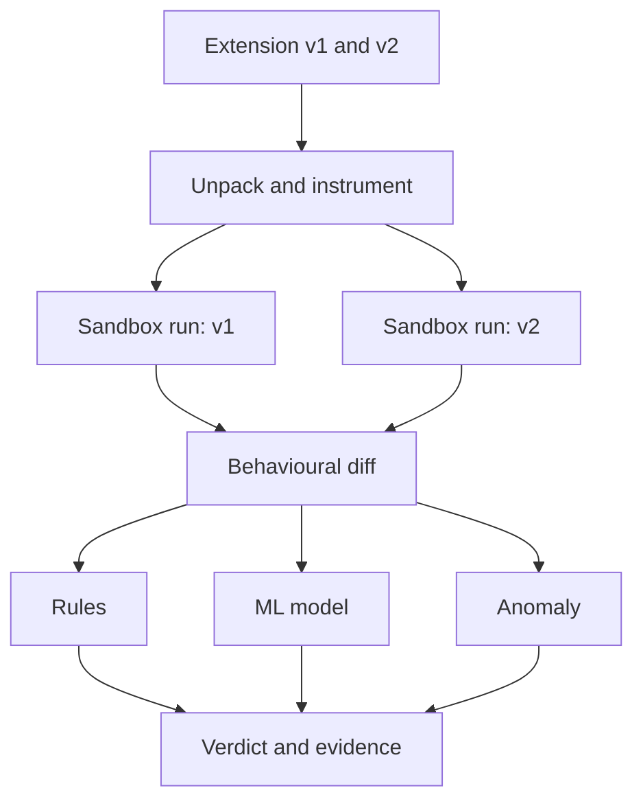
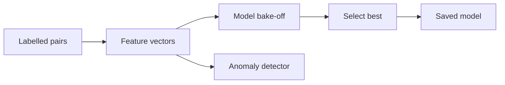

# extdrift

**Catch a browser extension the moment an update turns it malicious — by diffing what it *does*, not what its code says.**


A browser extension you trust can become spyware **overnight** through a single silent
auto-update — the browser grants its trust *once*, at install, and never re-checks it. The
**December 2024 Cyberhaven attack** did exactly this: a phished developer account pushed a
cookie-stealing update to ~2.6M users across dozens of extensions. Store review, permission
prompts, and code signing had all already passed the *benign* version.

**extdrift scores the *change*.** Give it two consecutive versions of the same extension; it
runs each in a sealed, deterministic sandbox, records what each actually does, diffs the
behaviour, and returns an **explainable verdict** — with transparent rules, a machine-learning
model, and an anomaly detector for the unseen.

---

## How it works



Each version runs in a headless sandbox — same scripted user actions, **byte-identical
pages**, network egress blocked — so the extension version is the *only* variable, and the
difference is the extension, not the noise of the live web. There are **two capture engines
behind one trace schema**: a Chromium engine (Playwright + `--host-resolver-rules`) and a
**Firefox engine** (Selenium temporary add-on + a local capture proxy) that turns the real
Firefox update pairs from the AMO collector into behavioural rows in the *same* format — so
real captured data trains the *same* model as the synthetic data, not a separate one. Four
channels are recorded — **network, DOM, storage/cookies, and `chrome.*`/`browser.*` API
calls** — reaching content scripts, the MV3 service worker and the MV2 background page (all
common exfiltration blind spots). The **behavioural delta**
`Δ = f(v2) − f(v1)` (26 features, incl. cross-component message-passing and destination-domain
reputation) is then scored three ways: transparent **rules**, an **ML
model**, and an **anomaly** detector, producing a `BENIGN / SUSPICIOUS / MALICIOUS` verdict with
the exact new behaviours that fired.

---

## Results that matter

Obfuscation hides the *code*, but the *runtime effect* is still visible — which is why a
dynamic diff beats static analysis on the case that matters most:

| On a payload that steals cookies | Static code-diff (prior work) | **extdrift (dynamic)** |
|---|---|---|
| Clean code | MALICIOUS ✓ | MALICIOUS ✓ |
| **Obfuscated code** | **BENIGN ✗ (missed)** | **MALICIOUS ✓ (0.99, leak confirmed)** |

And the machine-learning tier earns its place on the metric that decides whether a detector is
usable — the false-positive rate. On a hard **~1,000-pair** dataset (built with deliberate
overlap), under cross-validation that splits by extension:

| To catch 90% of malicious updates… | False positives |
|---|---|
| Transparent rules alone | flags **52%** of benign updates |
| **Learned model (XGBoost, the tabular SOTA)** | flags **~7%** |

*Anomaly layer:* trained only on benign updates, it flags malicious families it **never saw in
training** at **43–100%** (100% on credential/cookie theft, lower on stealthy families).

**Real-world validation — the synthetic distribution transfers to real extensions.** Real
Firefox update pairs from **15 extensions** (uBlock, AdBlock Plus, AdGuard, Dark Reader,
Privacy Badger, LanguageTool, SingleFile, FoxyProxy, …) are captured through the Firefox
engine into the *same* feature schema: real benign updates, and the same real extensions
weaponised with a real payload elicited by a Hulk-style HoneyPage. The decisive test trains
on **synthetic data only** and evaluates on the 45 real pairs it never saw:

| Held-out test on real extensions (45 pairs) | Result |
|---|---|
| Rules, malicious recall on real weaponised extensions | **30/30 (100%)** |
| **Model trained on synthetic only → tested on real** | **PR-AUC 0.998 · recall 0.93 · precision 1.0 · 0% FPR** |

Three benign updates (LanguageTool, Privacy Badger, Return-YouTube-Dislikes) trip a *rule* —
real false positives — but the *learned model* correctly calls all three benign (≤0.03): the
concrete case for ML over rules, on real data.

---

## Isolated Docker analysis

Run one extension, or two versions of it, inside hardened disposable containers on a network with no
route out. All traffic goes through mitmproxy, which answers everything locally and searches each
request for unique synthetic secrets, so "the password left the browser" is seen directly.

```bash
python -m engine.cli sandbox-build                                  # once
python -m engine.cli compare data/corpus/controlled/pair_v1 data/corpus/controlled/pair_v2
python -m engine.cli analyze path/to/extension.crx --browser firefox
```

```text
Verdict : Critical behaviour detected
Score   : 99/100 (Critical observed risk)
  - Synthetic credential values (password) were sent to telemetry-sync9.test. [credential_exfiltration, weight 0.97]
  - Read the entire cookie jar 3 times in 1 test scenario. [cookie_bulk_read, weight 0.50]
  - Read credential or payment field values 6 times in 1 test scenario (input#password). [credential_field_read, weight 0.35]
  - New high-risk permissions: cookies. [permission_escalation, weight 0.30]
Report  : out/analyses/<id>/report.html (also report.md, report.json)
```

The report has a 0-100 risk score with its evidence, a behaviour-level comparison of the versions,
the Random Forest's opinion, proof of the isolation checks, and a statement of what the run could not
show. The score reflects observed behaviour. It is not a probability of malice, and a low score does
not mean an extension is safe. See **[docs/SANDBOX.md](docs/SANDBOX.md)** for how it works, its isolation
limits, what it can and cannot observe, and [docs/design/RISK_CALIBRATION.md](docs/design/RISK_CALIBRATION.md)
for how the score behaves on labelled data. Real example reports are in [docs/examples/](docs/examples/).

## Quickstart without Docker

These are the original host-side paths. They run the extension directly on your machine with only
network sealing, so use them only with samples you trust.

```bash
pip install -r requirements.txt && playwright install chromium

# No browser — score three example update pairs instantly:
python scripts/demo_offline.py

# The real thing — load an extension in Chromium; a synthetic payload actually steals
# cookies, and we catch it:
python scripts/demo.py
```

```text
VERDICT   : MALICIOUS
Rules     : 0.99  [################################]   (6/12 fired)
ML model  : 0.88  [############################----]   (ml-xgboost, MALICIOUS; rules agree)
[ground truth] collector received data: True     ← the leak really happened
```

---

## The machine-learning approach

The model is chosen by **evidence, not convention**: five candidates — the interpretable rules,
Logistic Regression, Random Forest, XGBoost, and an SVM — race on the same behavioural-delta
features, judged by PR-AUC and false-positive rate under **cross-validation that splits by
extension and by time** (so it can't memorise an extension).



Selection is by PR-AUC and false-positive rate; the winner ships with SHAP-style feature
attribution. A separate **anomaly detector**, trained only on benign updates, flags behaviour no
model was trained on. The system predicts exactly one thing —
`P(this update introduced malicious behavioural change)` — and never claims more (no zero-day
*vulnerability* discovery). The rules stay as the interpretable control, and the learned model is
reported only when it beats them.

---

## Repository layout

```
engine/
  unpack/       .crx/.xpi unpacking + static manifest diff
  pipeline/     Docker pipeline orchestration, validation, states
  sandbox/      Docker sandbox + gateway, two capture engines, instrumentation, scenarios, synthetic web
  features/     trace schema, dynamic + static-code features, Δ = f(v2) − f(v1), behaviour diff
  scoring/      12 explainable heuristic rules; the 0-100 risk score and combined assessment
  synth/        synthetic update-pair corpus generator
  weaponiser/   real JS payloads (clean + obfuscated) → labelled malicious versions
  baseline/     static code-delta scorer (the prior-work baseline we beat)
  ml/           model bake-off, anomaly layer, live prediction
  collector/    real version collection (AMO API, Chrome Web Store + delisting probe, snapshots)
  report/       explainable text + JSON verdicts; JSON, Markdown and HTML security reports
config/         sandbox and risk-scoring settings
docker/         the two Dockerfiles and the seccomp profile
experiments/    ablations · learning curve · real static + behavioural capture (AMO/weaponised)
data/
  dataset/      the generated ~1,000-pair delta table (deltas.csv)
  real/         7,382 known-malicious extension IDs (public IOC DB, CC BY 4.0)
tests/          fast unit and integration tests, plus Docker end-to-end tests
```

> **Data.** The synthetic corpus is generated (`python -m engine.batch`) and committed as
> `data/dataset/deltas.csv`. Real known-malicious extension IDs come from the
> [chrome-mal-ids](https://github.com/mallorybowes/chrome-mal-ids) IOC database. Downloaded
> third-party extension code is **not** redistributed here.

## Tech stack

**Python** · **Playwright** (Chromium) + **Selenium** (Firefox) for the two capture engines ·
**scikit-learn** + **XGBoost** (the model tier) · **pandas / NumPy** · standard-library sandbox
test-site + capture proxy. The analysis + ML half is dependency-light and runs on a laptop;
only live browser capture needs a browser.

## Scope & honesty

- **This project:** dynamic, behavioural, cross-version diffing with record/replay determinism
  and explainable output — the open gap next to static update-diffing (*You've Changed*, CCS
  2020) and single-version dynamic analysis (*Hulk*; *ExtPrivA*, IEEE S&P 2023).
- **Deliberately out of scope:** consumer-side prevention before an update runs, discovery of
  unknown code vulnerabilities, and language-specific analysis — positioned instead for
  store / enterprise / researcher use.
- **Safety:** the Docker pipeline isolates the browser in a hardened container on a no-route
  network, though Docker alone is not a complete boundary for hostile samples (see
  [docs/SANDBOX.md](docs/SANDBOX.md)). The original host-side engines seal only the network and run
  the extension on the host itself. Either way, fake pages and dummy credentials are all that is
  exposed, and all egress is blackholed, so nothing (real extension traffic or injected-payload
  exfil) ever leaves the machine. Real extensions are analysed
  locally; their downloaded code is **never redistributed** (only our own behavioural traces
  and generated dataset are committed). Injected payloads are synthetic and beacon only to the
  local sandbox.

---

<sub>**CSD493 Project-1** · B.Tech CSE · Shiv Nadar Institution of Eminence · Bind Pratap Singh
& Suhani Deepak Agrawat · Advisor: Dr. Sweta Mishra. Academic research prototype for defensive
security research.</sub>
